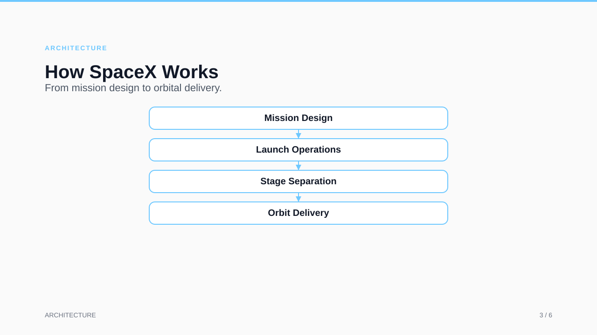
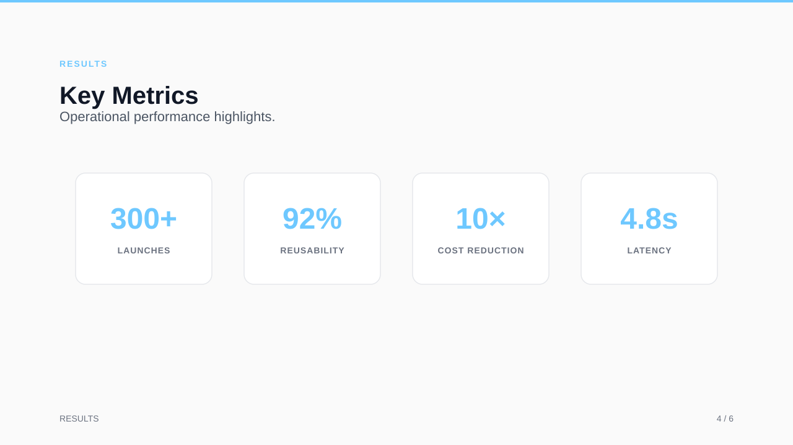
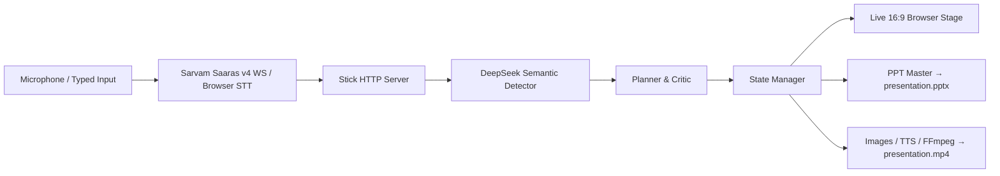

<p align="center">
  
</p>

<h1 align="center">Stick</h1>

<p align="center">
  <strong>Speak to build your presentation.</strong><br />
  Live decks, AI-generated visuals, multilingual voice support, and editable PowerPoint — created in real time as you speak.
</p>

<p align="center">
  <a href="#description">Description</a> ·
  <a href="#features">Features</a> ·
  <a href="#how-it-works">Architecture</a> ·
  <a href="#quick-start">Quick Start</a> ·
  <a href="#configuration">Configuration</a> ·
  <a href="#api">API</a> ·
  <a href="#verification">Verification</a>
</p>

---

## Description

> **Stick is a live presentation engine that builds structured slide decks while you speak.**  
> No templates to fill in, no timeline to edit first — just talk (or type), and Stick turns your ideas into a visual presentation in real time.

When `SARVAM_API_KEY` is configured, Stick streams microphone audio over a local WebSocket bridge (`communication/sarvam_realtime.py`) to **Sarvam Saaras v4**, displaying live partial transcripts and dispatching each completed utterance (with automatic language detection across English, Hindi, and 20+ Indian languages) to the AI pipeline. Without Sarvam, Stick falls back to browser `SpeechRecognition`, and a text box is always available for manual input.

A **DeepSeek-powered AI Director** (`semantic_detector.py`, `planner.py`, `critic.py`) evaluates incoming speech, selects the right layout (`hero`, `cards`, `pipeline`, `metric`, `quote`), keeps slides in the speaker's language, generates live visuals (**Pollinations**, **Cloudflare Worker**, or **Gemini**), and exports an editable `.pptx` deck incrementally via **PPT Master**.

<p align="center">
  
</p>

<p align="center"><em>Live session UI: welcome cover, real-time 16:9 stage preview, and Stick AI Director.</em></p>

---

## Features

| Feature | Details |
|---|---|
| **Realtime voice authoring** | Streams 16 kHz PCM audio to **Sarvam Saaras v4** (`sarvam-realtime`) with REST clip (`/speech/transcribe`) and browser `SpeechRecognition` fallbacks, plus a manual text-input box. |
| **Multilingual & Indian languages** | Sarvam auto-detects spoken languages (including **Hindi `hi-IN`**, English `en-IN`, and other Indian languages); planner and critic preserve the speaker's language across slide copy and `.pptx` export. |
| **AI Director pipeline** | DeepSeek semantic gate, memory retrieval, structured `stage_scene` planner, and critic validation choose between `hero`, `cards`, `pipeline`, `metric`, and `quote` layouts. |
| **Live AI slide imagery** | Non-blocking visual generation per scene using **Pollinations** (`POLLINATIONS_API_KEY`), **Cloudflare Worker** (`CF_WORKER_URL`), or **Gemini** (`GEMINI_API_KEY`). |
| **Incremental PPTX export** | Converts validated SVG slides into native editable PowerPoint decks via **PPT Master** in isolated per-session workspaces. |
| **Optional MP4 video export** | Scene narration, TTS (**Sarvam Bulbul**, **Gemini TTS**, or **Edge TTS**), and FFmpeg video composition when `VIDEO_ENABLED=true`. |
| **Session & memory isolation** | Each browser session gets its own orchestrator, state, workspace, and artifact directory; optional **Neon PostgreSQL** persists preferences and presentation memories. |

---

## Generated slides

Stick chooses layout and visual strategy per slide type:

<p align="center">
  
  &nbsp;&nbsp;
  
</p>

<p align="center">
  
</p>

<p align="center"><em>Exported SVG slides from PPT Master — hero, architecture, and metrics layouts.</em></p>

---

## How it works



**End-to-end path**

```text
Microphone audio → Sarvam Saaras v4 WS bridge (or REST / browser fallback) → /transcript
  → Orchestrator → Semantic Detector (DeepSeek) → Memory Retrieval → Planner → Critic
  → State Manager → Presentation State
      ├─→ Presentation Generator → PPT Master → artifacts/<session_id>/presentation.pptx
      └─→ Live Imagery & Multimedia Manager → Pollinations / Cloudflare / Gemini + TTS → presentation.mp4
```

Core separation of concerns (detailed in [docs/architecture.md](docs/architecture.md)):

- **Session** (`session.py`, `session_manager.py`) — lifecycle (`created → connected → active → disconnected → completed`)
- **Presentation state** (`state_manager.py`) — active/completed scenes, theme, metadata (per session)
- **Memory** (`memory/`) — durable PostgreSQL records scoped by user / presentation / session
- **Artifacts** (`presentation_generator/`, `multimedia/`) — isolated filesystem `.pptx`, images, audio, and `.mp4` under `PRESENTATION_ARTIFACT_DIR/<session_id>/`

---

## Quick start

### Prerequisites

- **Python 3.10+**
- **[DeepSeek API key](https://platform.deepseek.com/)** (required)
- Optional: **[Sarvam AI API key](https://www.sarvam.ai/)** for Saaras v4 realtime STT and Bulbul TTS
- Optional: **Pollinations API key**, **Cloudflare Worker URL**, or **Google Gemini API key** for live slide visuals
- Optional: **PPT Master** checkout (`PPT_MASTER_ROOT`) for PowerPoint export
- Optional: **Neon PostgreSQL** (`DATABASE_URL`) for persistent memory
- Optional: **FFmpeg** (`FFMPEG_PATH`) and `VIDEO_ENABLED=true` for MP4 rendering

### 1. Configure environment

Copy `.env.example` to `.env` in `STICK/` and fill in your keys:

```bash
cp .env.example .env
```

Minimum required configuration:

```env
DEEPSEEK_API_KEY=your_deepseek_key_here
```

Recommended additions:

```env
SARVAM_API_KEY=your_sarvam_key_here
POLLINATIONS_API_KEY=your_pollinations_key_here
PPT_MASTER_ROOT=/absolute/path/to/ppt-master
PRESENTATION_PORT=8001
```

> `DEEPSEEK_API_KEY`, `SARVAM_API_KEY`, `POLLINATIONS_API_KEY`, `GEMINI_API_KEY`, and `DATABASE_URL` stay server-side in `.env` and are never exposed to the browser.

### 2. Install dependencies and run

```bash
python -m venv venv
# Windows: venv\Scripts\activate
# macOS/Linux: source venv/bin/activate
pip install -r requirements.txt
python ingestion.py
```

### 3. Open the app

Visit **http://127.0.0.1:8001** in Chrome or Edge, click **Start live presentation**, and start speaking (in English, Hindi, or other Sarvam-supported languages). You can also type an idea directly into the text box below the microphone button.

Optional CLI speech-to-presentation mode (connects to the running server):

```bash
python speech_to_presentation.py --demo
# or interactive chunk mode:
python speech_to_presentation.py
```

---

## Configuration

### Core & LLM

| Variable | Default | Description |
| --- | --- | --- |
| `DEEPSEEK_API_KEY` | — | **Required.** Powers semantic detection, scene planning, and critic evaluation. |
| `DEEPSEEK_MODEL` | `deepseek-chat` | DeepSeek chat model ID |
| `DEEPSEEK_BASE_URL` | `https://api.deepseek.com` | DeepSeek-compatible API base URL |
| `PRESENTATION_PORT` | `8001` | Local HTTP server port |
| `PRESENTATION_LANGUAGE` | `en` | Default deck language (`en`, `hi`, `fr`, `es`, `de`, `ja`, `zh`) |
| `DATABASE_URL` | — | Optional Neon PostgreSQL connection string for persistent memory |
| `MIN_NEW_SCENE_SECONDS` | `15` | Dwell guard before starting a new slide on the same topic/kind |

### Speech (Sarvam Saaras STT & Bulbul TTS)

| Variable | Default | Description |
| --- | --- | --- |
| `SARVAM_API_KEY` | — | Enables Sarvam realtime WebSocket STT, REST `/speech/transcribe`, and Bulbul TTS |
| `SARVAM_STT_MODEL` | `saaras:v4` | Sarvam speech-to-text model |
| `SARVAM_STT_WS_PORT` | `8765` | Local WebSocket bridge port for browser PCM audio streaming |
| `SARVAM_TTS_MODEL` | `bulbul:v4-flash` | Sarvam TTS model (`bulbul:v4-flash` or `bulbul:v3`) |
| `SARVAM_TTS_SPEAKER` | — | Optional speaker override for Bulbul TTS |

### Visuals, PPT Master & Video

| Variable | Default | Description |
| --- | --- | --- |
| `POLLINATIONS_API_KEY` | — | Primary AI slide image provider |
| `CF_WORKER_URL` | — | Secondary Cloudflare Worker image provider (`/generate`) |
| `GEMINI_API_KEY` | — | Fallback image provider, narration text, and Gemini TTS |
| `PPT_MASTER_ROOT` | — | Path to PPT Master checkout for SVG validation & `.pptx` export |
| `PRESENTATION_ARTIFACT_DIR` | `artifacts` | Directory for per-session `.pptx`, images, and `.mp4` outputs |
| `VIDEO_ENABLED` | `false` | Enables `/presentation/video/generate` MP4 compilation |
| `FFMPEG_PATH` | `ffmpeg` | Path to FFmpeg binary |

---

## API

| Endpoint | Purpose |
| --- | --- |
| `GET /` | Serves the browser UI (`communication/static/index.html`) |
| `GET /health` | Reports backend, Neon DB, DeepSeek, Sarvam WS/REST, PPT Master, and multimedia status |
| `POST /session` | Creates an isolated presentation session |
| `POST /session/connect` | Marks a session as connected |
| `POST /session/disconnect` | Marks a session disconnected and clears session working memory |
| `POST /transcript` | Submits a final transcript snapshot (with optional detected `language`) to the orchestrator |
| `POST /scene` | Applies a direct `stage_scene` update payload |
| `POST /speech/transcribe` | Transcribes an audio clip via Sarvam REST STT |
| `GET /presentation?session_id=` | Returns current/completed scenes, generation status, and live imagery status |
| `GET /presentation/media?session_id=&scene_id=` | Serves generated slide visuals |
| `GET /presentation/download?session_id=` | Downloads the session's generated `presentation.pptx` |
| `POST /presentation/video/generate` | Starts background MP4 rendering |
| `GET /presentation/video/status?session_id=` | Checks video build status |
| `GET /presentation/video/download?session_id=` | Downloads the session's `presentation.mp4` |

---

## Project structure

```text
STICK/
├── communication/
│   ├── static/                   # Browser UI (index.html, stick-logo.svg, welcome-cover.svg)
│   ├── events.py                 # TranscriptEvent dataclass
│   ├── sarvam_realtime.py        # Local WebSocket bridge to Sarvam Saaras v4 streaming
│   └── server.py                 # HTTP server and REST endpoints
├── presentation_generator/
│   ├── export_scene.py           # Scene enrichment & retry compaction
│   ├── generator.py              # Debounced PPTX generation lifecycle
│   ├── models.py                 # GenerationResult & visual strategy helpers
│   ├── ppt_master_adapter.py     # PPT Master SVG validation & PPTX export adapter
│   ├── scene_images.py           # Scene image resolution for export
│   ├── slide_paths.py            # Slide file naming helpers
│   ├── svg_templates.py          # Kind-specific SVG slide templates
│   └── visual_strategy.py        # Layout & visual importance planner
├── multimedia/
│   ├── providers/                # Pollinations, Cloudflare Worker, Gemini, Sarvam STT/TTS, Edge TTS
│   ├── live_imagery.py           # Non-blocking per-slide AI image generation
│   ├── manager.py                # Video pipeline orchestration
│   ├── composer.py               # Slide + audio timeline composition
│   └── video_renderer.py         # FFmpeg MP4 export
├── memory/                       # Neon PostgreSQL repository, retrieval, and memory extraction
├── tests/                        # Unit & integration tests (pytest)
├── docs/                         # Architecture documentation & README image assets
├── ingestion.py                  # Main application entrypoint
├── orchestrator.py               # Session-scoped transcript -> scene pipeline
├── semantic_detector.py          # DeepSeek semantic gate
├── planner.py                    # DeepSeek scene planner
├── critic.py                     # DeepSeek scene critic
├── realtime_director.py          # Scene normalization and dwell guards
├── state_manager.py              # Atomic presentation state transitions
├── rendering.py                  # Frontend render-model builder
├── speech_to_presentation.py     # CLI speech chunk runner
├── config.py                     # Environment configuration loader
├── .env.example                  # Sample environment variables template
├── .gitignore                    # Ignores .env, caches, artifacts, and runtime media
└── requirements.txt              # Python dependencies
```

---

## Verification

Run the automated test suite and syntax checks:

```bash
python -m pytest tests/ -v
python -m py_compile *.py communication/*.py memory/*.py presentation_generator/*.py multimedia/*.py multimedia/providers/*.py
```

Additional standalone demo scripts are included at the repository root (`demo_reliability.py`, `demo_memory.py`, `demo_presentation_intelligence.py`, `demo_presentation_generation.py`, `demo_end_to_end.py`, `demo_realtime_director.py`, `demo_visual_composition.py`, `demo_real_ppt_master.py`, `demo_multimedia.py`, `demo_video_pipeline.py`).

---

## Security notes

- API keys and database credentials live only in `.env` (gitignored) and stay on the server.
- Each presentation session uses an isolated workspace and artifact directory under `artifacts/<session_id>/`.
- Never commit `.env`, credentials, or generated `artifacts/` containing user content.
